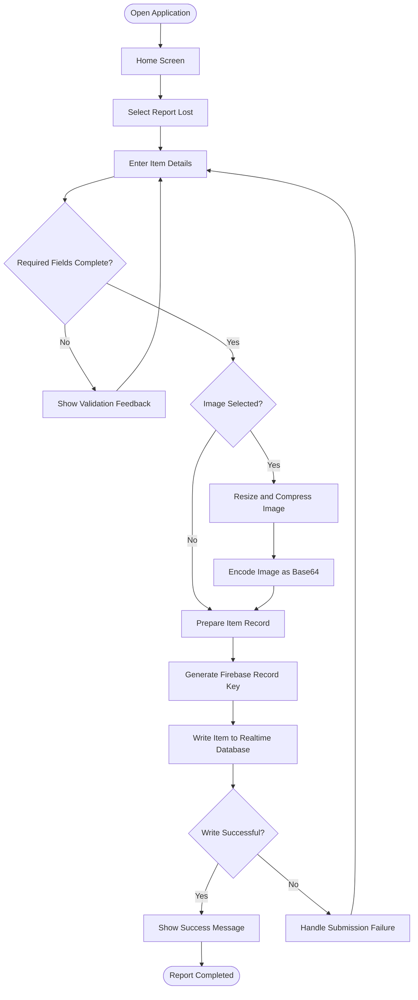
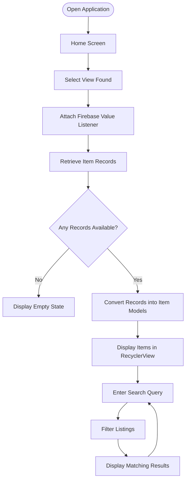
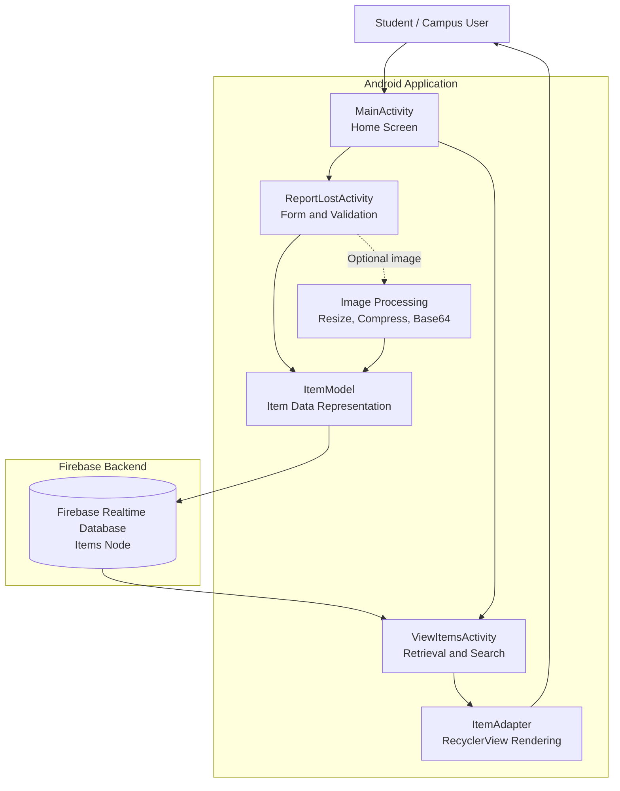

# 🎒 Smart Campus Lost & Found Portal
### Turning lost-item chaos into a smarter, connected campus.

<p align="center">

**An Android-based Lost & Found platform powered by Firebase Realtime Database**

</p>

Lost something on campus? Found an item that belongs to someone else? Instead of relying on scattered WhatsApp messages, class groups, or word of mouth, **Smart Campus Lost & Found Portal** provides a centralized place to report lost and found belongings and discover matching listings.

Built with **Java, XML, Android Studio, and Firebase**, this project demonstrates how a simple, accessible mobile application can help a campus community coordinate item recovery more efficiently.

---

## 📌 Table of Contents

- [The Problem](#-the-problem)
- [Our Solution](#-our-solution)
- [Key Features](#-key-features)
- [How It Works](#-how-it-works)
- [System Architecture](#-system-architecture)
- [Application Workflow](#-application-workflow)
- [Technology Stack](#-technology-stack)
- [Data Model](#-data-model)
- [Getting Started](#-getting-started)
- [Testing and Validation](#-testing-and-validation)
- [What Makes This Project Valuable?](#-what-makes-this-project-valuable)
- [Current Scope and Future Roadmap](#-current-scope-and-future-roadmap)
- [Sustainable Development Goals](#-sustainable-development-goals)
- [Project Structure](#-project-structure)
- [Team](#-team)
- [Contributing](#-contributing)
- [License](#-license)

---

## 🚨 The Problem

College campuses are busy environments where students frequently misplace personal belongings such as ID cards, notebooks, keys, water bottles, wallets, and electronic accessories.

Finding these belongings can be difficult because:

- Lost-item information is scattered across different communication channels.
- Students may not know whom to contact after losing an item.
- Found items may go unreported or remain unnoticed by their owners.
- Descriptions, locations, and contact information may be incomplete or difficult to search.
- Repeated enquiries consume students' time and create unnecessary coordination effort.

The core problem is not simply losing an item. It is the **lack of a centralized, searchable process for communicating lost-and-found information within a campus community**.

## 💡 Our Solution

Smart Campus Lost & Found Portal is an Android application that allows users to create structured listings for lost and found belongings and browse the available reports from one place.

Users can enter an item's name, location, contact number, description, and additional private details. They can optionally attach an image and mark a listing as sensitive. Submitted records are stored in Firebase Realtime Database and retrieved dynamically in the application.

The result is a practical foundation for a campus-wide lost-and-found service that can be extended with secure claims, notifications, and intelligent item matching.

**Our design principle:** Make reporting straightforward, make listings searchable, and make recovery easier to coordinate.

---

## ✨ Key Features

### 1. 📝 Structured Item Reporting

Users can submit a lost or found item report containing:

- Item name
- Last-seen or found location
- Contact number
- Description
- Additional private details
- Lost or Found status
- Sensitive-item indicator
- Optional item image

Required-field validation helps prevent incomplete submissions.

### 2. 🖼️ Optional Image Attachment

Users can select an image from their device gallery.

The current implementation resizes the selected image to 400 × 400 pixels, compresses it as JPEG, and encodes it in Base64 format before storing it with the item record.

This provides a simple prototype implementation without requiring a separate image-upload workflow. However, Base64 increases the amount of text stored in the database, so dedicated image storage is a planned improvement.

### 3. ☁️ Firebase-Powered Data Storage

Submitted listings are written to Firebase Realtime Database using generated record keys.

The application retrieves records through a Firebase value listener, allowing the listing screen to respond to database updates.

### 4. 🔎 Searchable Lost & Found Listings

The View Found screen uses a RecyclerView to display item records.

A SearchView filters the displayed listings, helping users find relevant records without manually browsing every entry.

### 5. 📱 Native Android Experience

The application uses Java and XML layouts in Android Studio, with a straightforward home screen that directs users to the reporting and browsing workflows.

### 6. ⚠️ Sensitive-Item Indicator

Users can mark a listing as sensitive and provide additional details separately from the public description.

This is currently a reporting feature, not a complete access-control or privacy system. Enforcing restricted access to sensitive information is part of the future roadmap.

---

## 🔄 How It Works

The application follows two primary workflows: reporting an item and browsing available listings.

### Workflow 1 — Report a Lost or Found Item



### Workflow 2 — Browse and Search Listings



These diagrams describe the intended application flow. Firebase write failures, image selection edge cases, and other exceptional paths should be verified through testing before claiming complete error-handling coverage.

---

## 🏗️ System Architecture

The application follows a lightweight Android client–database architecture.



### Architecture Components

| Component | Responsibility |
|---|---|
| MainActivity | Displays the home screen and navigation options. |
| ReportLostActivity | Collects item information, validates required fields, and submits reports. |
| ItemModel | Represents the item data stored in Firebase. |
| ViewItemsActivity | Retrieves database records and manages listing display and search. |
| ItemAdapter | Binds item data to RecyclerView rows. |
| Firebase Realtime Database | Stores and synchronizes item records. |
| Android Gallery Intent | Allows the user to select an optional image from the device. |

**Data flow:** The Android interface collects the information, the item model represents the report, Firebase stores the record, and the listing screen retrieves records for display and filtering.

The application currently uses Firebase directly from the Android client. A separate backend API, authentication system, and Firebase Storage upload pipeline are not part of the implemented architecture.

---

## 🛠️ Technology Stack

| Technology | Purpose |
|---|---|
| Java | Android application logic |
| XML | Android layouts and user interface |
| Android Studio | Development and debugging environment |
| Firebase Realtime Database | Cloud-hosted item records |
| RecyclerView | Efficient listing presentation |
| SearchView | Listing search and filtering |
| Android Intent | Gallery image selection |
| Base64 and JPEG compression | Encoding optional images for database storage |
| Gradle | Build configuration and dependency management |

---

## 🗃️ Data Model

Each item report is represented by an `ItemModel` object and stored under the `Items` node in Firebase Realtime Database.

The current implementation uses fields corresponding to the following information:

| Field | Purpose |
|---|---|
| Item name | Identifies the reported belonging |
| Location | Indicates where the item was lost or found |
| Contact number | Provides a contact method |
| Description | Gives a general description |
| Private details | Holds additional item information |
| Status | Distinguishes Lost from Found reports |
| Sensitive indicator | Records whether the item was marked sensitive |
| Image data | Holds the optional Base64-encoded image when supplied |

The exact serialized field names and null/default handling should be checked against the current `ItemModel.java` before integrating this description into a formal API specification.

A generated Firebase push key identifies each database record.

**Important:** The current `imageUrl` field contains Base64 image data rather than a conventional downloadable image URL.

---

## 🚀 Getting Started

Follow these steps to run the project locally.

### Prerequisites

- Android Studio
- A compatible Android SDK installation
- JDK compatible with the project configuration (Java 11 is specified)
- A physical Android device or Android emulator
- A Firebase project with Realtime Database enabled
- Internet access for Firebase operations

### 1. Clone the Repository

Replace the placeholder below with the actual public repository URL.

```bash
git clone <YOUR_GITHUB_REPOSITORY_URL>
cd SmartCampusLostFound
```

Alternatively, download the repository as a ZIP file and open the extracted project in Android Studio.

### 2. Configure Firebase

1. Open the project in Android Studio.
2. Open the Firebase Console: https://console.firebase.google.com/
3. Select the Firebase project associated with your application, or create a new one.
4. Register the Android application using its actual application ID: `com.example.smartcampuslostfound`.
5. Download `google-services.json`.
6. Place the file in the Android app module directory, normally `app/google-services.json`.
7. Confirm that the Google Services Gradle plugin and Firebase Realtime Database dependency are configured.
8. Enable Realtime Database and configure appropriate database security rules.

The current database URL is:

```text
https://smartcampuslostfound-5aa0e-default-rtdb.asia-southeast1.firebasedatabase.app
```

If you use your own Firebase project, configure the application for that project's database rather than relying on the original URL.

**Security note:** Never publish service-account credentials or private keys. Do not use publicly writable database rules in a deployed application. Client-side validation is not a substitute for backend security rules.

### 3. Open and Build

1. Open the project folder in Android Studio.
2. Allow Gradle synchronization to complete.
3. Check that Firebase configuration and dependencies resolve correctly.
4. Connect an Android device with USB debugging enabled, or start an emulator.
5. Build and run the application.

### 4. Try the Main Workflows

- Launch the application.
- Open Report Lost and submit a test report with the required fields.
- Optionally attach an image.
- Open View Found and verify that the report appears.
- Enter a search query to filter listings.
- Submit another report and verify that the listing screen responds to the database update.

Use test data rather than real personal contact information when demonstrating the project publicly.

---

## 🧪 Testing and Validation

Testing should verify the implemented functionality before the application is presented as hackathon-ready.

| Test case | Expected behaviour |
|---|---|
| Submit a complete report | Record is written and success feedback is shown. |
| Omit a required field | Submission is blocked by validation. |
| Submit without an image | Report can be submitted without an attachment. |
| Submit with an image | Image is processed and included in the record. |
| Open listings with existing data | Item records appear in the RecyclerView. |
| Search for a matching item | Relevant listings remain visible. |
| Open listings with no records | Empty state is displayed. |
| Add a new database record | The listing screen receives the database update. |
| Simulate a database failure | Error handling should be verified and improved where needed. |

These are validation scenarios, not a claim that every case has already passed. Record actual results on the test device before adding test counts, response times, reliability percentages, or performance claims to the project documentation.

---

## 🏆 What Makes This Project Valuable?

### A real problem in a familiar environment

Lost belongings are a relatable problem for students, faculty, and campus staff. The application addresses a specific coordination gap rather than introducing technology without a clear need.

### A complete core reporting-to-retrieval workflow

The project connects item reporting, structured data storage, database retrieval, and search within one Android application.

### Practical cloud integration

Firebase Realtime Database provides a cloud-backed data layer without requiring the team to develop and maintain a separate server for the current prototype.

### A foundation for responsible expansion

The modular separation between activities, the item model, and the adapter provides a foundation for adding features such as verified ownership claims, secure contact handling, and better image storage.

### Honest engineering

The current application is a working foundation, not a claim of fully automated recovery. AI-based matching, push notifications, authentication, and verified ownership workflows are potential extensions rather than existing capabilities.

**Our central contribution is the implementation of a structured mobile workflow that makes campus lost-and-found information easier to report, retrieve, and search.**

---

## 🔮 Current Scope and Future Roadmap

The following roadmap distinguishes implemented functionality from planned improvements.

| Capability | Current status |
|---|---|
| Android home screen and navigation | Implemented |
| Lost/found item reporting | Implemented |
| Required-field validation | Implemented |
| Optional gallery image selection | Implemented |
| Image compression and Base64 encoding | Implemented |
| Firebase Realtime Database writes | Implemented |
| Dynamic database retrieval | Implemented |
| RecyclerView listing | Implemented |
| Search filtering | Implemented |
| User authentication and verified campus identity | Planned |
| Secure ownership-claim workflow | Planned |
| Push notifications for potential matches | Planned |
| Firebase Storage for image uploads | Planned |
| Admin moderation and report management | Planned |
| Automated duplicate detection | Planned |
| AI-assisted lost/found matching | Planned |
| Privacy controls and access restrictions | Planned |

### Phase 1 — Secure and Reliable Core

- Add user authentication and, where possible, campus identity verification.
- Introduce secure claim requests and ownership verification.
- Strengthen Firebase access rules and input validation.
- Improve database error handling and loading states.
- Move image storage to Firebase Storage and store download references in item records.

### Phase 2 — Better Discovery

- Add filters for item category, date, location, and Lost/Found status.
- Improve duplicate-report detection.
- Introduce a structured claim status and resolution history.
- Add notifications when relevant reports are created.

### Phase 3 — Intelligent Matching

Develop an AI-assisted matching service that compares lost and found reports using attributes such as item category, descriptive text, location, and date.

A future matching pipeline could:

1. Retrieve eligible lost and found reports.
2. Normalize descriptions and extract relevant attributes.
3. Compare candidate pairs using a transparent scoring method.
4. Rank possible matches for the user.
5. Let users review candidates and initiate a claim.
6. Require ownership verification before an item is handed over.

Any future AI matching system should be evaluated using labelled examples, false-match rates, and missed-match rates. Automated scores should suggest possible matches, not independently establish ownership.

---

## 🌍 Sustainable Development Goals

### SDG 11 — Sustainable Cities and Communities

The project has an **indirect connection** to SDG 11 through improved information sharing and coordination within a campus community.

Official reference: https://sdgs.un.org/goals/goal11

### SDG 12 — Responsible Consumption and Production

Recovering lost belongings may reduce unnecessary replacement purchases and support reuse. This is a potential benefit; the project has not yet measured changes in consumption or waste.

Official reference: https://sdgs.un.org/goals/goal12

These are potential areas of alignment, not evidence that the application has already achieved measurable SDG outcomes.

---

## 📂 Project Structure

The Android application is organized around its primary screens, item data model, and listing adapter.

```text
SmartCampusLostFound/
├── app/
│   ├── src/
│   │   └── main/
│   │       ├── java/
│   │       │   └── com/example/smartcampuslostfound/
│   │       │       ├── MainActivity.java
│   │       │       ├── ReportLostActivity.java
│   │       │       ├── ViewItemsActivity.java
│   │       │       ├── ItemModel.java
│   │       │       └── ItemAdapter.java
│   │       ├── res/
│   │       │   └── layout/
│   │       └── AndroidManifest.xml
│   ├── build.gradle
│   └── google-services.json
├── build.gradle
├── settings.gradle
└── README.md
```

This is a representative structure. Confirm the actual file locations in Android Studio before treating it as an exact directory listing. Do not commit `google-services.json` if it contains configuration you intend to keep private; in all cases, keep credentials out of version control and enforce database access controls.

---

## 👥 Team

**Project:** Smart Campus Lost & Found Portal

**Developers**

- Thenmalar Devarajan
- Uma Maheshwari N R

**Department:** Computer Science and Engineering  
**Institution:** Chennai Institute of Technology, Chennai, India

---

## 🤝 Contributing

Contributions and constructive feedback are welcome.

1. Fork the repository.
2. Create a feature branch.
3. Implement and test your changes.
4. Submit a pull request describing the problem addressed and the changes made.

Potential contribution areas include secure authentication, improved search filters, claim verification, storage optimization, accessibility, and automated testing.

---

## 📜 License

No license has been specified yet. Add an appropriate license file before inviting external reuse or contributions. Until then, the repository should not be assumed to grant broad reuse permissions.

---

## 💬 Final Note

Smart Campus Lost & Found Portal begins with a simple idea: **finding a lost belonging should not depend on knowing the right person or searching through dozens of messages.**

By centralizing reports and making them searchable, the project establishes a practical starting point for a more connected campus recovery system.

The next step is to build on that foundation with secure claims, reliable notifications, better media storage, and carefully evaluated intelligent matching.

**Built for campus communities. Designed for practical recovery. Ready to evolve.**
